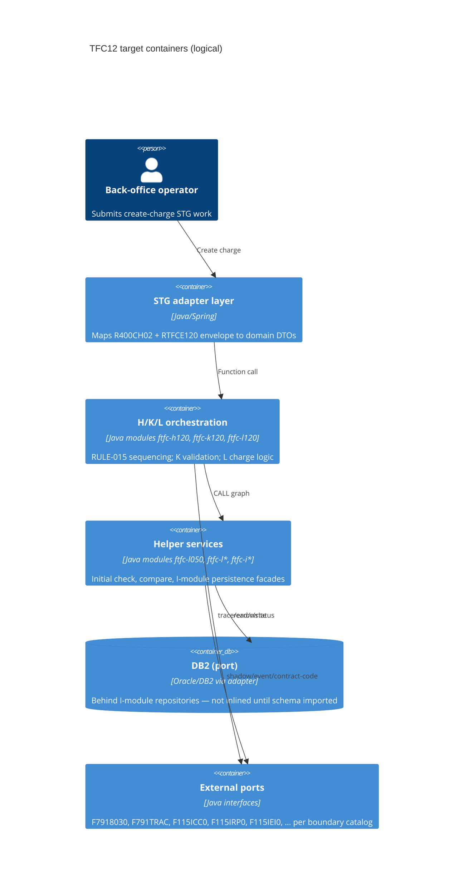
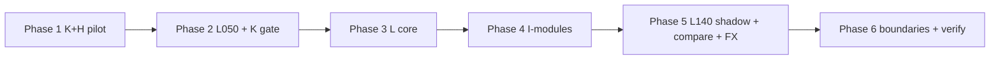

# Modernization Brief — TFC12

**Target stack:** Java 21 / Spring Boot 3.x  
**Track:** Transform (strangler-fig)  
**Status:** **Approved — full plan (Phases 1–6)** — 2026-09-30  
**Legacy:** `legacy/TFC12/` → `legacy/STG/TFC12/`  
**System label:** `TFC12` (Create charge / charges and pricing — omkostninger)

**Input timestamps (2026-09-30):** [`PREFLIGHT.md`](PREFLIGHT.md), [`ASSESSMENT.md`](ASSESSMENT.md), [`topology.json`](topology.json), [`BUSINESS_RULES.md`](BUSINESS_RULES.md), [`RULE_REVIEWS.json`](RULE_REVIEWS.json), [`INTENT.md`](INTENT.md), [`SCOPE.md`](SCOPE.md)

---

## 1. Objective

Modernize the **TFC12/01** Servo STG flow (**FTFCH120 → FTFCK120 → FTFCL120** and in-repo one-hop helpers) from fixed-format mainframe COBOL to **Java 21 / Spring Boot 3.x** in this standalone repo, preserving charge validation, ILC/collection payer rules, initial-check semantics, and L-module charge/shadow behavior. The driver is repeatable, test-backed transformation without expanding the import-locked legacy closure unless the preflight expansion log records an approved import. External CALL/COPY documented in [`BOUNDARY_CATALOG.md`](BOUNDARY_CATALOG.md) become explicit ports ([`DECISIONS.md`](DECISIONS.md)).

---

## 2. Target Architecture



| Legacy component | Target component(s) | Notes |
|------------------|----------------------|--------|
| `FTFCH120` | `ftfc-h120` | Orchestrator; ports for F791TRAC, F7918030 |
| `FTFCK120` | `ftfc-k120` | Generated + user C5xx deps; calls L050 adapter |
| `FTFCL120` | `ftfc-l120` | Charge paths, shadow trigger, compare helpers |
| `F115L050` | `ftfc-l050` | Initial check; **no E000** on main path (RULE-017) |
| `F115L030`, `F115L060`, `F115L070`, `F115L080` | `ftfc-l030`, `ftfc-l060`, … | Compare/timestamp tiers |
| `F115L140` | `ftfc-l140` | Shadow; ports for external ICC0/IRP0/IEI0/L040 |
| `F115ICA0` … `F115IPC0`, `F115ISC0`, `F115ISR0` | `ftfc-ica0`, … | DB facades + external read/update variants |
| `F116L030` | `ftfc-fx130` (or `ftfc-l030-fx`) | Currency exchange |
| `RTFCE120` / `R400CH02` | `stg-envelope` module DTOs | R400CH02 copybook is boundary — adapter from STG header contract |
| External CALL targets (45) | `boundary.*` ports | See [`BOUNDARY_CATALOG.md`](BOUNDARY_CATALOG.md) |

**Maven reactor (target):** `modernized/TFC12/pom.xml` aggregating modules above.

---

## 3. Phased Sequence

Phase 1 is a **pilot** on **FTFCK120** (+ minimal **FTFCH120** shell). Findings from the pilot (missing port contract, reorder, env fact) **should revise this brief** — regenerating after Phase 1 is normal.

**Complexity index (assessment):** ~58 relative — scales below rank effort vs each other, not calendar time.



#### Phase 1 — K-module + H skeleton (pilot)

Command: /code-modernization:modernize-transform  
Modules: FTFCK120, FTFCH120  
Scale: M  
Risk: Medium; (1) generated META vs hand C5xx sections — capture in `TRANSFORMATION_NOTES.md`; (2) charge-table dependency rules — golden tests from RULE-005–007  
Entry criteria:

- [x] Brief **full plan (Phases 1–6)** approved in §8 — 2026-09-30  
- [x] `modernized/TFC12/pom.xml` reactor scaffold exists — 2026-09-30  
- [x] Pilot module id **FTFCK120** named in phase playbook — 2026-09-30  
Exit criteria:

- [x] `cd modernized/TFC12 && mvn test` green for `ftfc-k120` (+ `ftfc-h120` smoke) — 2026-09-30  
- [x] **RULE-004**, **RULE-005**, **RULE-006**, **RULE-007** covered by automated tests  
- [x] **RULE-015** — H performs K then L invocation order characterized at H level (L may stub)  
- [x] **RULE-016** decimal-comma test on at least one numeric path  

#### Phase 2 — Initial check (F115L050) integrated with K

Command: /code-modernization:modernize-transform  
Modules: F115L050, FTFCK120  
Scale: M  
Risk: Medium; (1) F115ISR0/ISC0/IMC0 calls — stub ports until Phase 4; (2) RULE-003 permanent-status — needs IMC0 port behavior  
Entry criteria:

- [x] Phase 1 exit criteria met — 2026-09-30  
- [x] `ftfc-l050` module added to reactor — 2026-09-30  
Exit criteria:

- [x] **RULE-012** — K calls L050; FM / E101–E102 propagation tests — 2026-09-30  
- [x] **RULE-001**, **RULE-002**, **RULE-003** proven for L050 paths (ports for IMC0/ISR0/ISC0 as fakes with recorded fixtures)  
- [x] **RULE-017** — E000 **not** invoked on main path (confirmed review)  

#### Phase 3 — L-module core charge processing

Command: /code-modernization:modernize-transform  
Modules: FTFCL120, F115L030, F115L060, F115L070, F115L080  
Scale: L  
Risk: High; (1) L is ~1.9k LOC with multiple calc switches; (2) compare-helper parity — tier tests per helper  
Entry criteria:

- [x] Phase 2 exit criteria met — 2026-09-30  
- [x] **RULE-014** shadow trigger rules understood from `G060-Create-Shadow` trace notes — [`TRACE_G060_SHADOW.md`](TRACE_G060_SHADOW.md)  
Exit criteria:

- [x] **RULE-014** — shadow path when main contract not in progress — 2026-09-30  
- [x] L invokes compare helpers with tests tied to F100/D200 paragraphs  
- [x] **RULE-013** PA-Seq-No zero path characterized at L050/L boundary  

#### Phase 4 — I-modules (persistence facades)

Command: /code-modernization:modernize-transform  
Modules: F115ICA0, F115ICH0, F115IMC0, F115IPA0, F115IPC0, F115ISC0, F115ISR0  
Scale: XL  
Risk: High; (1) EXEC SQL semantics without full COPY closure; (2) external F115*AR/AU variants — port list from each module  
Entry criteria:

- [x] Phase 3 exit criteria met — 2026-09-30  
- [x] DB port interfaces documented in `modernized/TFC12/BOUNDARY_PORTS.md` — 2026-09-30  
Exit criteria:

- [x] Repository/adapters replace in-tree SQL modules for happy-path CRUD used by L/K — 2026-09-30  
- [x] Contract tests for ICA0/ICH0/IMC0/IPA0/IPC0 linkage copybooks in-repo  
- [x] Sys-code reads (**F115ISC0**, **F115ISR0**) support K **RULE-008**–**011** tests with fakes  

#### Phase 5 — Shadow orchestration, ILC rules, FX

Command: /code-modernization:modernize-transform  
Modules: F115L140, F116L030, FTFCK120  
Scale: XL  
Risk: High; (1) L140 ~2.9k LOC + external fan-out; (2) **RULE-009**, **RULE-010**, **RULE-008** need full charge-table fixtures  
Entry criteria:

- [x] Phase 4 exit criteria met — 2026-09-30  
- [x] Ports for **F115ICC0**, **F115IRP0**, **F115IEI0**, **F115L040** defined — 2026-09-30  
Exit criteria:

- [x] **RULE-008**, **RULE-009**, **RULE-010**, **RULE-011** automated on K — 2026-09-30  
- [x] L140 shadow flow integrated with **F115IMC0**; external calls via ports — 2026-09-30  
- [x] **F116L030** FX path test for cross-currency persona flow — 2026-09-30  

#### Phase 6 — External boundaries, verify, harden

Command: /code-modernization:modernize-transform  
Modules: FTFCH120, (boundary ports catalog)  
Scale: M  
Risk: Medium; (1) trace/error adapters F7918030/F791TRAC; (2) verify without COBOL dual-run — trace suite only  
Entry criteria:

- [x] Phases 1–5 exit criteria met — 2026-09-30  
- [x] `equivalence/cases.json` draft lists priority scenarios (optional import from parity lane **into this repo** only if expansion log updated) — 2026-09-30  
Exit criteria:

- [x] `/modernize-verify TFC12` completed; all **P0** rules **PROVEN** or **PARTLY PROVEN** with documented gaps — 2026-09-30  
- [x] Optional `/modernize-harden TFC12` if requested — 2026-09-30  
- [x] `analysis/TFC12/VERIFICATION.md` published — 2026-09-30  

---

## 4. Business Walkthroughs

| Persona | Flow (business language) | Legacy modules | Replaced in phase |
|---------|---------------------------|----------------|-------------------|
| Back-office operator | Submit create-charge for contract/part; system validates, computes charges, persists | H→K→L050→L→I* | P1–P4 |
| Pricing specialist | Set percent charges; shadow/status updates | K, L, L140, external ICC0/IEI0/IRP0 | P2, P3, P5 |
| Treasury user | Cross-currency charge with conversion | L, F116L030, I-modules | P4, P5 |

Derived from [`topology.json`](topology.json) `flows` (2026-09-30).

---

## 5. Behavior Contract

All **P0** rules below must be **PROVEN** (automated characterization) before the phase that owns them ships. **RULE-017** is P2 but **confirmed** — binding for L050 ([`CONFIRMED.md`](CONFIRMED.md)).

| Rule ID | Name | Primary phase |
|---------|------|---------------|
| RULE-001 | F115L050 requires function and medium | 2 |
| RULE-002 | Invalid status and operation-type combination | 2 |
| RULE-003 | Permanent status blocks in-progress main contract | 2 |
| RULE-004 | K mandatory envelope fields | 1 |
| RULE-005 | Charge row requires Selected when Charge-Type present | 1 |
| RULE-006 | Charge row requires amount or percent when type present | 1 |
| RULE-007 | Charge row requires Paying-Party when type present | 1 |
| RULE-008 | RETURN or EXPIRE uniform paying party side | 5 |
| RULE-009 | SETTLE-ILC PRES-BANK-CHARGES payer CUSTM | 5 |
| RULE-010 | ACCEPT-ILC paying party CUSTM | 5 |
| RULE-011 | Selected charge requires Paying-Party indicator | 5 |
| RULE-012 | K-module initial check calls F115L050 | 2 |
| RULE-015 | H invokes K then L in sequence | 1 |
| RULE-016 | Decimal point is comma | 1 |

No P0 rule is **`wrong`** or **`discuss`** in [`RULE_REVIEWS.json`](RULE_REVIEWS.json).

---

## 6. Validation Strategy

| Phase | Approach |
|-------|----------|
| 1–2 | JUnit 5 characterization tests from COBOL paragraphs; stub L and I ports |
| 3–5 | Module integration tests; fake DB and boundary ports with fixture JSON |
| 6 | Aggregate `mvn test`; trace-based equivalence where COBOL cannot run ([`TOOLCHAIN.md`](TOOLCHAIN.md)); optional scenario JSON under `analysis/TFC12/equivalence/` |

No local COBOL dual-execution. Production telemetry was not available at assess time.

---

## 7. Open Questions

Approver: tick when resolved.

- [ ] **R400CH02 STG header** — confirm field mapping source for Java DTO (copybook not in closure; port contract from integration team?)  
- [ ] **DB2 schema** — import DDL/copybooks for SQL includes vs continue with repository mocks for Phase 4 exit  
- [ ] **Parity scenario subset** — whether to copy selected JSON scenarios from external parity lane into this repo (requires legacy expansion / legal approval)  
- [ ] **Spring Boot boundary** — single deployable JAR vs library-only modules for STG embedding (default: library modules + thin Spring Boot test app)  

---

## 8. Approval Block

**Approved 2026-09-30** — project owner (explicit chat approval).

```
Approved by: project owner (chat)  Date: 2026-09-30
Approval covers: [ ] Phase 1 only   [x] Full plan (Phases 1–6)
```

Next command (run when ready):

```text
/modernize-transform TFC12
Cap parallel Task subagents at 5 for this project.
```

Steering note: edit **entry/exit criteria** in this file to steer execution; the build commands treat edited checkboxes as binding.
